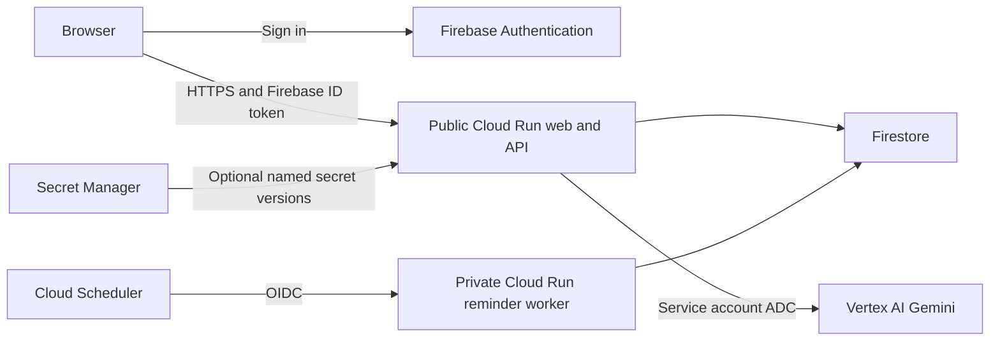

# Purrfect Home GCP setup

**Demo update:** this copy now uses automatic guest sessions instead of a login form.
For an existing deployment, use [REDEPLOY_DEMO.md](REDEPLOY_DEMO.md). Firebase
anonymous sign-in and the web service's guest-access flag are managed by Terraform.

This guide deploys this copy of Purrfect Home using Terraform, Firebase Authentication, Firestore, Cloud Run, Vertex AI and Cloud Scheduler. It includes the application code as well as the infrastructure. No cloud resources were created while preparing this repository. You will review and apply the Terraform plans in your own project.

## What runs where



The web service serves both the React application and `/api/v1`, so there is no cross-origin API configuration. Cloud Run allows public HTTP access to serve the demo. The browser automatically obtains an anonymous Firebase session; the API verifies its ID token and revocation. The worker is a separate private service. Only the scheduler service account receives its invoker role.

The existing TypeScript simulation also runs on the server. Clients send actions, not final scores or snapshots. Transactions check account revisions and trial versions. Request IDs make retries safe. Household versions and trial events are immutable documents. Gemini produces suggestions or narrative only; it cannot write Firestore or approve adoption.

## 1. Prerequisites and project

Install Node.js **24.12 or newer**, npm, Terraform **1.6 or newer (below 2)**, and the Google Cloud CLI. Local emulator tests also need Java 21 or newer. Docker is optional: the build instructions below use Cloud Build.

Use a **new, dedicated GCP project with billing enabled**. Choose a globally unique project ID such as `purrfect-home-yourname-dev`. A project ID is different from its display name and numeric project number. These identifiers are not secrets.

For an existing Firebase project, import its existing Firebase project, Auth configuration, default Firestore database and rules release into Terraform before applying. Do not create a second default database or overwrite an existing application's rules. This configuration denies all direct browser Firestore access.

Commands below use **PowerShell**, from the repository root:

```powershell
$projectId = "YOUR_PROJECT_ID"
$region = "asia-southeast1"
gcloud auth login
gcloud config set project $projectId
gcloud auth application-default login
gcloud auth application-default set-quota-project $projectId
```

`gcloud auth login` authenticates the CLI. `application-default login` separately authenticates Terraform and local server libraries. Neither command writes credentials into this repository. Cloud Run does not need either login: it uses its assigned service account automatically.

The person applying infrastructure needs permissions to enable APIs, manage Firebase/Auth/Firestore, create Cloud Run services, IAM bindings, service accounts, Artifact Registry, Scheduler and buckets. A project owner can bootstrap a **new development project**. For a team, have an administrator assign only the needed provisioning roles; do not give the running application Owner or Editor. The supplied runtime roles are declared in `infra/main.tf`.

Set a billing budget and alerts in the Cloud Billing console. Budgets are alerts, not spending caps. Firestore point-in-time recovery, builds, storage, model calls and requests can incur charges even though Cloud Run scales down to zero. Web instances are capped at three; this is not a financial spending limit.

## 2. Create the private Terraform state bucket

The state bucket is deliberately outside the application Terraform root so it survives application teardown. Create it once, with a globally unique name:

```powershell
$stateBucket = "$projectId-terraform-state"
gcloud services enable storage.googleapis.com serviceusage.googleapis.com cloudresourcemanager.googleapis.com iam.googleapis.com
gcloud storage buckets create "gs://$stateBucket" --location=$region --uniform-bucket-level-access --public-access-prevention
gcloud storage buckets update "gs://$stateBucket" --versioning
```

Restrict bucket access to infrastructure maintainers. Terraform state and saved plans may contain sensitive configuration even when output is marked `sensitive`. Never publish the bucket or commit state, plans, credentials or filled-in `.tfvars` files. GCS provides Terraform state locking; do not bypass a lock held by someone else.

## 3. Provision the foundation

```powershell
Copy-Item infra/terraform.tfvars.example infra/terraform.tfvars
```

Edit `infra/terraform.tfvars`:

```hcl
project_id         = "YOUR_PROJECT_ID"
region             = "asia-southeast1"
gemini_model_id     = "YOUR_VERTEX_GEMINI_MODEL_ID"
vertex_location    = "global"
deploy_services    = false
image              = ""
authorized_domains = ["localhost"]
```

Find a supported Gemini model ID in Vertex AI Model Garden in your project and confirm access/quotas. Do not copy an outdated model name from the original source comments. `global` is a routing location, not a guarantee of regional processing. If data residency matters, select a supported regional endpoint and confirm the selected model is available there. Firestore's database location is a separate, effectively permanent choice; select it before the first apply.

```powershell
terraform -chdir=infra init "-backend-config=bucket=$stateBucket" "-backend-config=prefix=purrfect-home/dev"
terraform -chdir=infra validate
terraform -chdir=infra plan -out=foundation.tfplan
terraform -chdir=infra apply foundation.tfplan
```

Read the plan before applying. This first phase enables APIs and creates Firebase/Auth, the web-app registration, Firestore with deny-all client rules, IAM, Artifact Registry, the build staging bucket and any optional secret containers. It does not require a container image yet. Retain `infra/.terraform.lock.hcl` in Git for repeatable provider selection.

If API enablement or IAM propagation causes a first-apply error, wait briefly and rerun the plan. Do not delete/recreate Firestore to resolve an IAM propagation error. Organization policies can prohibit public Cloud Run invokers; in that case an administrator must approve an appropriate public frontend architecture before deployment.

## 4. Put IDs and settings in `.env`

After the foundation apply:

```powershell
npm ci
node scripts/configure-local.mjs
```

The script reads Terraform outputs and creates `.env`. It refuses to overwrite an existing file. Alternatively, copy `.env.example` and fill the fields manually. The values also appear in:

```powershell
terraform -chdir=infra output -json browser_config
terraform -chdir=infra output -json server_config
```

| Setting | Where it goes | Secret? |
| --- | --- | --- |
| `VITE_APP_MODE=gcp` | Local `.env`; Docker sets it for cloud builds | No |
| `VITE_FIREBASE_API_KEY` | `.env`; public build argument | No: Firebase browser API identifier |
| `VITE_FIREBASE_AUTH_DOMAIN` | `.env`; public build argument | No |
| `VITE_FIREBASE_PROJECT_ID` | `.env`; public build argument | No |
| `VITE_FIREBASE_APP_ID` | `.env`; public build argument | No |
| `APP_MODE=gcp` | `.env`; Terraform runtime environment | No |
| `GOOGLE_CLOUD_PROJECT` | `.env`; Terraform runtime environment | No |
| `AI_PROVIDER=vertex` | `.env`; Terraform runtime environment | No |
| `GCP_LOCATION`, `GEMINI_MODEL_ID` | `.env`; Terraform runtime environment | No |
| `AI_DAILY_LIMIT` | Server environment, default 40 per user per UTC day | No |
| Google service-account private key | **Not needed; do not create/download one** | Yes |
| Future third-party API token | Local `.env`; production Secret Manager | Yes |

**Every `VITE_` variable is public.** Vite embeds these values in downloadable JavaScript. Never use names such as `VITE_GEMINI_SECRET` or `VITE_PRIVATE_KEY`.

Firebase's browser key identifies the Firebase project; it does not authorize access to user records. Access is controlled by Firebase Auth, API ownership checks, and Firestore IAM/rules. In Google Cloud Credentials, verify that the Firebase-created key has appropriate API restrictions. Test any further restriction against Firebase sign-in, account creation and token refresh. Never use this browser key as a Vertex AI credential.

`.env` is ignored by Git, Docker and Cloud Build. The production container does **not** load your local `.env`; Terraform injects server configuration. Browser configuration is built into the image, so rebuild when changing Firebase projects. Runtime-only model settings can change with a Terraform apply.

For a local cloud-connected run, change generated `NODE_ENV=production` to `NODE_ENV=development` (or remove it), then:

```powershell
npm run dev
```

For an offline demo, copy `.env.example`, keep both modes set to `demo` and `AI_PROVIDER=mock`. Existing browser demo data is **not automatically uploaded** into an account. Cloud sign-in uses separate data and starts from the clearly labelled synthetic demonstration household.

Optional, for local application testing only: to reduce local privileges, use service-account impersonation after an administrator grants your developer account `roles/iam.serviceAccountTokenCreator` on the web service account. Skip this switch while following the deployment steps:

```powershell
$webAccount = terraform -chdir=infra output -raw web_service_account
gcloud auth application-default login --impersonate-service-account=$webAccount
```

Use the provisioning identity for Terraform; a runtime identity intentionally cannot provision infrastructure. ADC login is machine-wide, so switch it deliberately between these purposes. Do not set `GOOGLE_APPLICATION_CREDENTIALS` on Cloud Run.

## 5. Build the image without sending secrets

If you used the optional impersonation login above, first switch ADC back to the same user account that successfully performed step 3. The runtime web service account does not have Terraform state-bucket access. A missing `iam.serviceAccounts.getAccessToken` permission means impersonation failed before storage access was checked.

```powershell
gcloud auth application-default login
gcloud auth application-default set-quota-project $projectId
```

From the repository root:

```powershell
$browser = terraform -chdir=infra output -json browser_config | ConvertFrom-Json
$imageRepo = terraform -chdir=infra output -raw image_repository
$builder = terraform -chdir=infra output -raw build_service_account
$sourceBucket = terraform -chdir=infra output -raw build_source_bucket
$tag = Get-Date -Format "yyyyMMdd-HHmmss"
$image = "${imageRepo}:$tag"
$substitutions = "_IMAGE=$image,_FIREBASE_API_KEY=$($browser.VITE_FIREBASE_API_KEY),_FIREBASE_AUTH_DOMAIN=$($browser.VITE_FIREBASE_AUTH_DOMAIN),_FIREBASE_APP_ID=$($browser.VITE_FIREBASE_APP_ID)"
gcloud builds submit . --config=cloudbuild.yaml --project=$projectId --service-account="projects/$projectId/serviceAccounts/$builder" --gcs-source-staging-dir="gs://$sourceBucket/source" --substitutions=$substitutions
```

These substitutions contain only public Firebase configuration. The build account has Artifact Registry write access, build-source read access and log-writer access; it does not receive database or model privileges. The submitting user needs Cloud Build build-creation permission, staging-bucket upload permission and `iam.serviceAccounts.actAs` on the build account. Do not grant these permissions to the web runtime identity.

The Docker build uses `npm ci` and the committed npm lockfile. The original Bun lockfile is retained as upstream history, but npm is authoritative for this deployment; do not use the stale Bun lockfile to install this modified copy.

## 6. Deploy the services

Resolve the pushed image to a digest for repeatable deployment:

```powershell
$digest = gcloud artifacts docker images describe $image --format="value(image_summary.digest)" --project=$projectId
$immutableImage = "${imageRepo}@$digest"
```

Update `infra/terraform.tfvars`: set `deploy_services = true` and `image` to the full value of `$immutableImage`. Keep these values in the file for subsequent applies; using only a one-off `-var` risks unintentionally reverting them later.

```powershell
terraform -chdir=infra plan -out=deploy.tfplan
terraform -chdir=infra apply deploy.tfplan
$serviceUrl = terraform -chdir=infra output -raw service_url
$serviceHost = ([uri]$serviceUrl).Host
```

Add `$serviceHost` to `authorized_domains` in your `.tfvars`, keeping `localhost` for local work, and apply another reviewed plan. Add a custom domain there as well if you later configure one. Firebase Auth authorized domains contain hostnames only, without `https://` or paths.

Open the service URL: a private guest session starts automatically without a login form. Save a household and run a trial. Anonymous sign-in is enabled by Terraform; the server accepts these verified sessions through `DEMO_GUEST_ACCESS=true`. Each browser has separate data. Clearing browser storage loses access to that guest session. Review Firebase signup and Vertex project quotas before a wider launch.

The scheduler calls the private worker daily at 09:00 Asia/Kuala_Lumpur using OIDC. The worker rechecks current preferences and writes one generic in-app notice per due cycle. Cloud Run IAM authenticates the scheduler before the worker receives the request. Do not add an `allUsers` binding to the worker.

## 7. Correct secret handling and rotation

**Firebase Admin, Firestore and Vertex AI require no static application key in this design.** Cloud Run obtains short-lived credentials from its assigned service account. Never put service-account JSON into `.env`, a Docker build argument, a Terraform variable, Git, or the frontend.

If you later implement an integration that actually needs a third-party secret:

1. Add metadata only to `secret_environment` in `.tfvars`, for example `PARTNER_API_TOKEN = { secret_id = "partner-api-token", version = "1" }`.
2. Create the secret container and IAM binding before deploying a revision that references version 1. For a first deployment, do this during the foundation phase. For an already deployed app, use a reviewed targeted plan for the secret and its IAM binding, or create/import the secret first; do not change `deploy_services` back to false because that would propose removing services.
3. Add its value through Secret Manager's console, or a secure local file outside this repository:

```powershell
gcloud secrets versions add partner-api-token --data-file="C:\secure\partner-token.txt" --project=$projectId
```

4. Apply the full reviewed plan to deploy the web revision referencing that numeric version. The application must explicitly read `process.env.PARTNER_API_TOKEN` server-side when that integration is implemented; defining a secret does not implement the integration.
5. For rotation, add a new secret version, change the metadata's version number, apply, and verify the new revision. Retire old Cloud Run revisions/traffic before disabling the old secret version. Revoke the old credential at its issuer when safe.

Secret values never pass through Terraform; there is deliberately no `google_secret_manager_secret_version` resource. Marking a Terraform value `sensitive` only hides some display output; it does not remove the value from state. Numeric versions make deployments reproducible. The runtime receives accessor permission only for explicitly configured secrets.

If a key is accidentally committed, revoke/rotate it first, inspect access logs, then coordinate repository history cleanup. Deleting the visible file does not remove history. This repository is connected to Lovable: do not rewrite published history casually.

## 8. Verification

Local checks:

```powershell
npm run typecheck
npm test
npm run build
npm run test:cloud
terraform -chdir=infra fmt -check
terraform -chdir=infra validate
```

`test:cloud` starts Firebase Auth and Firestore emulators under the special `demo-purrfect-home` project ID, then starts the compiled web and worker servers locally. It must not be pointed at a real project. Ports 8087, 8088, 8089 and 9099 must be free. It verifies missing-token rejection, two-account isolation, idempotent retries, stale revision rejection, immutable snapshots, a seven-day trial/report, reminder deduplication and deletion. Run `build` first. Java 21+ is required by current Firestore emulator releases.

After cloud deployment, verify these separately because emulator tests cannot establish real IAM, regional availability or billing configuration:

- `/health` responds; `/api/v1/state` without a Firebase bearer token returns 401.
- Account A can save and reload data; account B cannot see A's trials.
- Two tabs making conflicting updates cause a visible conflict instead of silently overwriting trial results.
- A completed trial/report survives a refresh in the same browser session; a second private browser session is isolated.
- Vertex extraction works with your selected model; model failure falls back to scripted assistance. Check sanitized `ai_fallback` logs and report model attribution.
- An unauthenticated call to the worker is rejected by Cloud Run IAM. An authorized scheduler run creates only one notice per due cycle.
- “Delete my data” removes application records. It deliberately retains the Firebase sign-in account; administrators can separately delete that account in Firebase Auth. Firestore PITR/backup retention is separate from live-record deletion.

## 9. Current scope and operational limits

- This is a cloud integration of the existing synthetic demo. Real shelter onboarding, listing moderation and “send to rescuer” are not implemented. Listings remain the bundled approved synthetic seed set, shared by browser and server.
- To keep one simulation implementation, the backend uses Node/TanStack Start on Cloud Run rather than introducing a separate Python/FastAPI service. User records are nested beneath `users/{uid}` instead of copying the specification's top-level collection layout. These intentional mappings are documented in `docs/GCP_IMPLEMENTATION.md`.
- In-app scheduled reminders are implemented. FCM background delivery, push-token registration and service-worker push handling are not implemented. The existing browser attention alert works while the app is running; its label now describes that behavior.
- The repository adapter currently hydrates a user's complete trial/version history. This preserves the existing synchronous screen selectors, but large histories increase reads, latency and transaction work. Before a high-volume launch, add paginated history projections and load events only for the active trial. Cloud Run autoscaling alone does not solve that per-user query cost.
- AI requests have input bounds, a twenty-second model-request timeout, validation, fallback and a per-user daily limit. Guest sessions can be recreated, so this does not replace project quotas or project-wide abuse controls.
- New trials use rules version 1.1.0 and require feeding actions; owning a bowl no longer generates automatic meals. Old 1.0.0 trials preserve their previous feeding model. These illustrative coefficients do not predict real adoption outcomes.

## 10. Updates, rollback and cleanup

For updates, run checks, build a newly tagged image, resolve its digest, update `.tfvars`, review the plan and apply. Roll back by setting the previous known-good digest and applying another plan. Keep database/schema changes backward-compatible with rollback revisions.

Cloud Run and Firestore deletion protection are enabled. Do not run `terraform destroy` as routine cleanup. To intentionally retire a disposable project, export any needed records, pause the scheduler, understand retained backups, explicitly disable deletion protection in a reviewed apply, and then review a destroy plan. The separate state bucket is retained; manage its versions and access deliberately.

## Troubleshooting: Auth creation returns 403 / quota project missing

If `google_identity_platform_config.auth` fails even after setting the ADC quota project, compare the error's `metadata.consumer` project number with your target project. Terraform's Firebase (`google-beta`) provider must send the quota project explicitly. `infra/versions.tf` now sets `user_project_override = true` and `billing_project = var.project_id`. API bootstrapping continues through the separate `google` provider.

From the `infra` directory, generate a **new** plan after this correction; do not reapply a previously saved plan:

```powershell
terraform validate
terraform plan -out=foundation-quota-fixed.tfplan
# Review the plan, then:
terraform apply foundation-quota-fixed.tfplan
```

Already-created infrastructure remains in Terraform state. Do not destroy it or remove state to retry Auth creation. The applying identity needs `serviceusage.services.use` on the quota project (included in `roles/serviceusage.serviceUsageConsumer`) as well as permissions to configure Auth. If the fresh request still fails, check the new error's consumer project and verify that `identitytoolkit.googleapis.com` is enabled in the target project. `terraform validate` checks configuration, not live API authorization.

See [Firebase's provider configuration guidance](https://firebase.google.com/docs/projects/terraform/get-started#set_up_your_provider).

## Official references

- [Cloud Run service identity and ADC](https://docs.cloud.google.com/run/docs/configuring/services/service-identity)
- [Cloud Run Secret Manager integration](https://docs.cloud.google.com/run/docs/configuring/services/secrets)
- [Firebase ID token verification](https://firebase.google.com/docs/auth/admin/verify-id-tokens)
- [Firebase API keys are public project identifiers](https://firebase.google.com/docs/projects/api-keys)
- [Vertex AI authenticated requests](https://docs.cloud.google.com/vertex-ai/generative-ai/docs/start/quickstart)
- [Authenticated Scheduler requests to Cloud Run](https://docs.cloud.google.com/run/docs/triggering/using-scheduler)
- [Terraform GCS backend](https://developer.hashicorp.com/terraform/language/backend/gcs)
